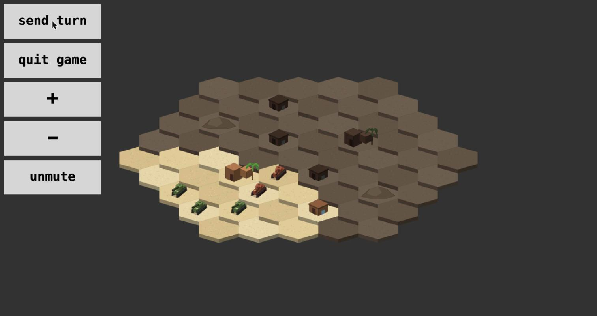

# tank-ops

A multiplayer, turn-based tank game for the browser. Hex grid, fog of war, a
shrinking arena, and simultaneous orders: both players plan, then the turn
resolves. Client in TypeScript (canvas), server in Go (websockets).



## Play

You need Go 1.22+, TypeScript (`tsc`) and `make`.

```
make run          # builds the client, serves on http://localhost:8000
```

Open it in a browser, then either

- pick **easy**, **medium** or **hard bot** to play the computer, or
- type a room code and **join room**; share the code with a friend who joins the same room.

### How a turn works

1. Give each tank one order: **move** (drag a path up to 5 hexes) or **fire** (pick one of six directions, range 3).
2. Press **send turn**. When both players have sent (or the 90 s turn timer runs out) the turn resolves.
3. One player's orders resolve before the other's, and the order flips every turn. Nobody is told who is first.
4. You only see enemies within 2 hexes of one of your tanks. Shots are stopped by obstacles and tanks.
5. After a few turns the outer ring of the arena starts collapsing. Tanks on a collapsing ring are destroyed.
6. Last side with a tank wins.

## The computer opponent

The bot plays by the same rules and sees only what you see. Levels:

| level  | behaviour |
| ------ | --------- |
| easy   | advances on the enemy and shoots when lined up (misses some chances) |
| medium | scores every move and shot: threats, cover, spread, the closing arena |
| hard   | medium's shortlist, tested against many guesses of the enemy's position and orders using the real game rules, two turns deep. It also works out who resolves first from the turn results. |

`go test -run TestBotStrength ./...` plays them against each other.

## Development

```
make test         # fast tests with the race detector
make test-full    # also the slow bot-vs-bot strength comparison
make check        # vet, tests, and a TypeScript type check
```

Environment variables for the server: `ADDR` (default `localhost:8000`),
`STATIC_DIR` (default `web/dist`), `PPROF_ADDR` (off unless set).

Layout:

- `main.go`, `hub.go` – HTTP server, websocket entry, room lookup
- `room.go`, `player.go` – per-room and per-connection state machines
- `gamestate.go` – the rules (pure, no networking)
- `bot.go` – the computer opponent
- `config.go` – maps and rules
- `web/src` – the client; `web/dist` is served as-is after `tsc`
- `tools/gen_assets` – generators for the sprites and sounds
- `docs/protocol.md` – the websocket protocol (build your own client or bot)

### Regenerating art and sound

All sprites and sound effects are generated by scripts in this repo, so they
are original and covered by the project license.

```
pip install pillow numpy
python3 tools/gen_assets/gen_sprites.py   # web/dist/assets/sprites.png + web/src/sprites.ts
python3 tools/gen_assets/gen_sounds.py    # web/dist/assets/sounds.wav
```

## Contributing

See [CONTRIBUTING.md](CONTRIBUTING.md). Ideas for first contributions: new
maps in `config.go`, keyboard controls, better bot behaviour, accessibility.
The full roadmap is in [docs/IMPROVEMENT_PLAN.md](docs/IMPROVEMENT_PLAN.md).

## License

[MIT](LICENSE). This covers the code and the generated art and sound.
